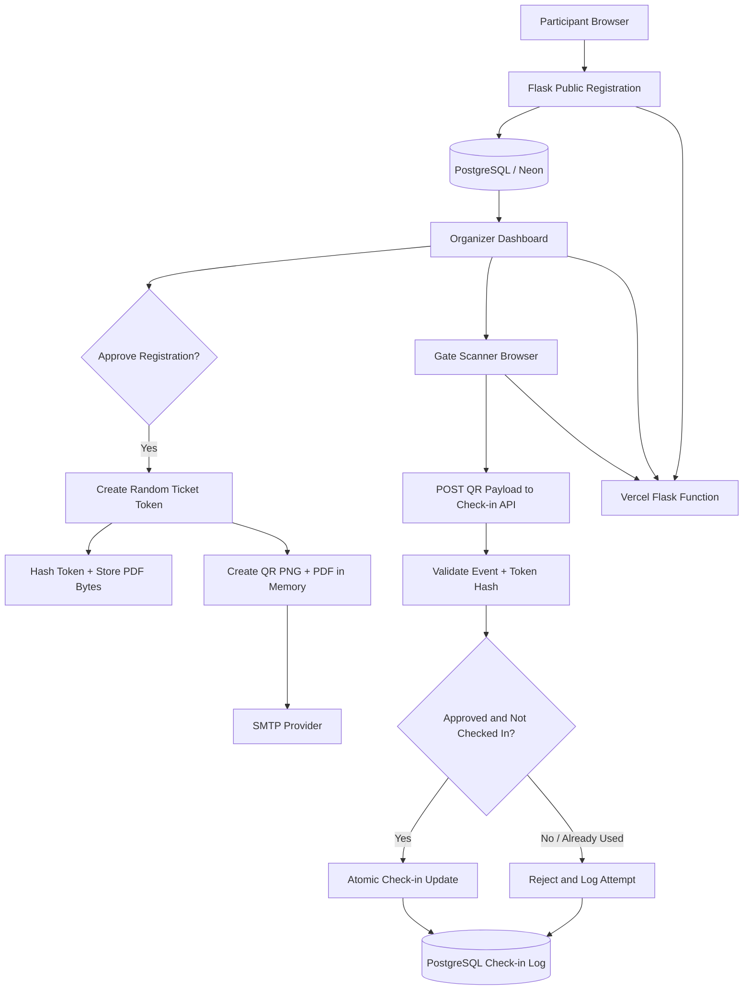

# EventPass — Technical Architecture

## Production architecture



## Local and production modes

- Local development uses SQLite under Flask's `instance/` directory.
- Vercel production uses PostgreSQL through `DATABASE_URL` (Neon pooled connection recommended).
- Vercel's deployment filesystem is read-only apart from temporary `/tmp` storage. PDFs are therefore generated in memory and stored in the `registrations.ticket_pdf_data` BLOB/BYTEA column. Local `.eml` previews are written to `instance/outbox/`; hosted deployments log a safe preview notice instead of pretending temporary files are durable.

## Main design decisions

1. **Application structure:** Flask application factory, public/auth/admin blueprints, service modules and a root `app.py` WSGI entry point for Vercel.
2. **Ticket secrecy:** QR code carries a random 256-bit-class secret token. The database stores only its SHA-256 digest. The QR payload contains no participant PII.
3. **PDF durability:** PDF bytes are stored in the database, not a local serverless filesystem.
4. **One-time entry:** SQLAlchemy issues a conditional database `UPDATE` with `checked_in_at IS NULL`. Only the first request can update a row; subsequent scans are logged as duplicate.
5. **Multiple events:** Each registration belongs to an event and each QR payload includes that event's public slug. A ticket scanned at another event is rejected.
6. **Multiple gates:** Each scanner submits a gate name to the same deployed application and shared database.
7. **Approval workflow:** Public registration starts as `pending`; a ticket is issued only after organizer approval.
8. **Email reliability:** Ticket hash and PDF bytes are committed before attempting SMTP delivery. A mail failure does not undo the approved registration or active PDF ticket.
9. **Security:** CSRF protection, password hashing, authenticated organizer pages, secure session cookie flags, security headers and environment-based secrets.

## State models

### Event status

- `draft`: not publicly available.
- `published`: registration can be available until its deadline; gate can be opened.
- `closed`: registration and check-in disabled.
- `cancelled`: event cancelled; check-in disabled.

### Registration status

- `pending`: awaiting organizer review.
- `approved`: ticket can be issued and checked in.
- `rejected`: not eligible for entry.
- `cancelled`: reserved for a future cancellation workflow.

### Check-in result

- `valid`: first successful entry.
- `duplicate`: ticket was already used.
- `invalid`: malformed, wrong-event, unknown or non-approved ticket.
- `closed`: gate is not open for the event.

## Database entities

```text
User 1 ───── * Event
Event 1 ──── * Registration
Event 1 ──── * CheckInLog
Registration 1 ──── * CheckInLog
```

## Concurrency and production note

The check-in endpoint does not rely only on a read-then-write sequence. It uses a conditional update at the database layer. This reduces race conditions between scanners. Before a real high-volume event, also test PostgreSQL under concurrent scans, configure database backups, rate limits, monitoring and a gate-operator policy. QR possession by itself does not prove a participant's identity.
